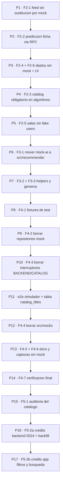

# Plan de ejecución — "Sin mock" (paquetes de trabajo)

> Fecha: 2026-10-14 · Fuente de verdad del QUÉ: `docs/vertice/plan-sin-mock.md` (F2–F5).
> Este documento define el CÓMO en paquetes `P1…P17`, cada uno ejecutable en **una sola
> tarea de modo Code**, en el orden indicado.
>
> Reglas de trabajo (heredadas de `plan-sin-mock.md` / `plan-ajustes-oct13.md`): una tarea
> cada vez; marcar `[x]` + «Hecho:» solo tras `npm run verify` y
> `node scripts/auditoria-estilos.mjs` en verde; un commit por paquete; **sin `git push`**;
> sin ejecutar los "pasos del dueño" (señalan y se documentan).
>
> Convenciones de los paquetes:
> - **Dep.** = paquetes que deben estar completados antes.
> - **Verif.** = criterios mínimos para dar el paquete por hecho (comandos + resultado esperado).
> - **Riesgo/Degradación** = qué hacer si falta credencial o entorno externo: nunca bloquearse;
>   degradar (mock local solo en tests) y documentar en el «Hecho:».

---

## 1. Resumen ejecutivo

El plan `plan-sin-mock.md` tiene 16 apartados de trabajo (F2-1…F5-3). **Ninguno está
implementado todavía** (el plan se escribió hoy). Lo que SÍ existe y se reutiliza
(~10% del esfuerzo total ya hecho): el RPC `predict_tenths` + `contentPredictTenths()`
con test (aunque nadie lo llama — eso es F2-2), el catálogo PostgREST (`postgrest.repository.ts`),
el simulador de Supabase para E2E (`e2e/supabaseMock.ts`), los scripts de auditoría
(`verify`, `scan:secrets`, `auditoria-estilos.mjs`, `rls-check.mjs`, `verify-catalog.mjs`)
y la suite E2E completa (103 suites / 704 tests en verde según `ESTADO.md`).

El trabajo se divide en **17 paquetes**:

| Fase del plan | Paquetes |
|---|---|
| FASE 2 (arreglos de producción) | P1…P5 |
| FASE 3 (reubicar lógica real) | P6…P7 |
| FASE 4 (borrar el modo mock) | P8…P14 |
| FASE 5 (datos que no existen) | P15…P17 (P16/P17 requieren decisión del dueño) |

**Dependencia global (orden de ejecución):**



Nota: P1…P5 son independientes entre sí (pueden encadenarse en ese orden sin riesgo);
P6 depende de que P4 y P5 hayan dejado los algoritmos y las salas estables.

---

## 2. Estado actual vs plan (verificado contra el código, 2026-10-14)

| Punto del plan | Estado | Evidencia actual |
|---|---|---|
| F2-1 (H1) feed sustituido por mock | ❌ Sin hacer | [`src/services/recommender.ts:17`](../../../src/services/recommender.ts) importa `CATALOG as MOCK_CATALOG`; [`recommender.ts:119-121`](../../../src/services/recommender.ts) `MOCK_CATALOG.find(...)` en `mediaFromRpcRow` |
| F2-2 (H2) predicción ficha sin RPC | ❌ Sin hacer | [`supabase/rating.repository.ts:34`](../../../src/services/supabase/rating.repository.ts) usa solo `predictTenths` (heurística); `contentPredictTenths` existe en [`recommender.ts:89`](../../../src/services/recommender.ts) sin llamadores |
| F2-3 (H3) `catalog = CATALOG` por defecto | ❌ Sin hacer | `hiddenGems.ts` (6 firmas, l.33-109), `moodFilters.ts:93`, `onboardingDeck.ts:22` |
| F2-4 (H6) deploy cae a mock | ❌ Sin hacer | [`.github/workflows/deploy.yml:29`](../../../.github/workflows/deploy.yml) `vars.CATALOG \|\| 'mock'` |
| F2-5 (H4/H5) salas con datos falsos | ❌ Sin hacer | [`useGroupSwipe.ts:9-10`](../../../src/features/room/useGroupSwipe.ts) importa `FAKE_USERS`/`FAKE_HISTORY`; rama `BACKEND` l.83-87; `RoomError` vive en [`fakeSocket.ts`](../../../src/mocks/fakeSocket.ts) y lo importan `supabase/room.repository.ts:4` y su test |
| F2-6 (H7) textos demo | ❌ Sin hacer | `app/account.tsx:56,192-195`, `app/(tabs)/profile.tsx:111,262-266`; `src/features/profile/resetPrototype.ts` existe (sin usos en app) |
| F3-1 mover `mock-ai` | ❌ Sin hacer | 8 módulos + `__tests__` en `src/mocks/mock-ai/`; 20+ imports `@/mocks/mock-ai` en producción y tests |
| F3-2 helpers medios | ❌ Sin hacer | `mediaKeyOf/titleOf/releaseYearOf/runtimeOf/mainGenreId` en `src/mocks/data/catalog.ts`; los usa `supabase/rating.repository.ts:4`, `useGroupSwipe.ts:8`, `moodFilters.ts:5`, `hiddenGems.ts:4` |
| F3-3 géneros | ❌ Sin hecho | `GENRES`/`genresFromIds` en `src/mocks/data/genres.ts`; los usa `app/(tabs)/explore.tsx:11`, `supabase/catalog/mapper.ts:6` |
| F4-1 fixtures de test | ❌ Sin hecho | 23+ tests importan `@/mocks` (lista completa en P8) |
| F4-2 repositorios mock | ❌ Sin hacer | [`src/services/index.ts:29-37`](../../../src/services/index.ts) `lazy` + switches; 8 repos mock + `supabase/catalog/mock.repository.ts` + 2 `select.ts` |
| F4-3 env sin switches | ❌ Sin hacer | [`src/lib/env.ts:19-20`](../../../src/lib/env.ts) `BACKEND`/`CATALOG`; consumidores: `_layout.tsx:84`, `useAuthStore.ts:121`, `useAvailabilityNotifications.ts:116`, `profile.tsx`, `account.tsx`, `recommender.ts:32`, `useGroupSwipe.ts:83`, `e2e/ensure-dist.mjs:22` |
| F4-4 borrar `src/mocks/` | ❌ Sin hacer | 24 ficheros en `src/mocks/` |
| F4-5/F4-6 docs y capturas | ❌ Sin hacer | `scripts/capturas-ui.mjs` sirve build mock con `localStorage` sembrado; `e2e/supabaseMock.ts` **no** tiene tabla `catalog_titles` |
| F4-7 verificación final | ❌ Sin hacer | — |
| F5-1 auditoría catálogo | ❌ Sin hacer | no existe `docs/vertice/catalogo-salud.md` |
| F5-2 créditos (opcional) | ❌ Sin hacer | migraciones solo hasta `0023_history_logged_at.sql`; `catalog-backfill` tiene modos `titles`/`runtime` (sin `credits`) |
| F5-3 keywords (opcional) | ❌ Sin hacer (sin planear; decisión del dueño) | — |

**Infraestructura ya disponible (se reutiliza, no se reescribe):**
- `contentPredictTenths`/`contentRecommend` + `activeRecommender` (recommender.ts) con tests.
- `postgrestCatalogSource` con `byIds/candidates/browse/search` (P1 usa `byIds` como opción).
- `e2e/supabaseMock.ts`: GoTrue completo, PostgREST con `eq/neq/in/lt/lte/gt/gte/is/like/ilike/cs/cd`,
  `delete-account` y `tmdb` (404 el resto). **Le faltan**: tabla `catalog_titles`, operador
  `or=(...)`, `websearch_query` y `order` multi-columna (P11).
- `e2e/helpers.ts` exporta `bootApp(page, { state, signedIn, extraStorage })` — reutilizable
  para las capturas (P13).
- La BD **ya guarda géneros por entrada**: `history_entries.genre_ids` y
  `initial_ratings.genre_ids` (los carga [`supabase/profile.repository.ts:33-46`](../../../src/services/supabase/profile.repository.ts)
  como `initialGenres`, aunque el store de perfil hoy los descarta — P6).

---

## 3. Paquetes

### P1 · F2-1 — El feed nunca sustituye un título real por uno del mock

**Dep.** — (inicio)
**Objetivo:** `mediaFromRpcRow` construye el `Media` siempre desde la fila del servidor.

**Archivos:**
- Modificar `src/services/recommender.ts`: borrar el import de `MOCK_CATALOG` (l.17) y las
  líneas 119-121 de `mediaFromRpcRow` (`MOCK_CATALOG.find` + `if (inMock) return inMock`).
  Se conserva la rama fallback existente (título vacío → `null`). Opcional (si el RPC no trae
  géneros/plataformas y se quiere enriquecer el feed): completar con
  `postgrestCatalogSource.byIds(media_type, [tmdb_id])` — **no es obligatorio** para este
  paquete; se decide en la tarea si el carril queda pobre.
- Modificar `src/services/recommender.test.ts`: test nuevo siguiendo el patrón de mock de
  `getSupabase` del fichero: una fila del RPC `recommend` con `tmdb_id = 52` (id que SÍ existe
  en el mock con otro título) y `title` distinto debe devolver el **título de la fila**, no el
  del mock.

**Verif.:** `npx jest src/services/recommender.test.ts` verde (test nuevo incluido) ·
`npm run verify` · `node scripts/auditoria-estilos.mjs`.
**Riesgo:** si algún test del feed asume el enriquecimiento por mock, fallará → actualizar la
aserción (es el bug que se corrige, no un fallo colateral).

---

### P2 · F2-2 — La predicción de la ficha usa el modelo real (RPC `predict_tenths`)

**Dep.** P1 (mismo dominio, mismo `verify` compartido; no hay dependencia técnica estricta)
**Objetivo:** feed y predicción comparten modelo (H2).

**Archivos:**
- Modificar `src/services/supabase/rating.repository.ts` (rama `else` de `saveRating`,
  l.31-36): si `activeRecommender() === 'content'`, llamar a
  `contentPredictTenths(mediaRef.mediaType, mediaRef.mediaId)`; si devuelve `number` (ya clamp
  10-50 dentro de la función), usarlo; si devuelve `null` o lanza, caer a
  `predictTenths(buildTasteProfile(...), media, key)` (heurística actual).
  **No** tocar la rama `existing` (l.28-30: no recalcular si la entrada ya existía).
- Revisar `src/features/detail/useDetailData.ts`: la ficha ya muestra `saved.aiPrediction`
  (devuelve `rowToEntry(row)` del repositorio) → verificar que no hace falta cambio; si lo
  hace, anotarlo en el «Hecho:».
- Modificar `src/services/supabase/rating.repository.test.ts`: 3 escenarios:
  (a) RPC `predict_tenths` devuelve p. ej. `34` → `ai_prediction_tenths === 34`;
  (b) RPC devuelve `null`/error → se usa la heurística (el mock de `predictTenths` ya existe);
  (c) entrada existente → no se vuelve a calcular (se conserva el valor guardado).
- Modificar `docs/vertice/ESTADO.md`: línea "feed y predicción comparten modelo (RPC
  `predict_tenths`) — 2026-10-14".

**Verif.:** `npx jest src/services/supabase/rating.repository.test.ts` · `npm run verify` ·
auditoría de estilos.
**Riesgo:** `activeRecommender()` degrada a `heuristic` sin sesión/`RECOMMENDER≠content` →
en tests sin sesión sigue rindiendo la heurística (comportamiento esperado).

---

### P3 · F2-4 + F2-6 — El despliegue nunca cae a mock + quitar textos de demostración

**Dep.** P2
**Objetivo:** cerrar H6 (riesgo de despliegue) y H7 (UI).

**Archivos:**
- Modificar `.github/workflows/deploy.yml`:
  - l.29: `EXPO_PUBLIC_CATALOG: ${{ vars.CATALOG || 'tmdb' }}`.
  - Nuevo paso `Guard against mock` ANTES de `npm run build:web` (bash):
    ```yaml
    - name: Guard against mock
      shell: bash
      env:
        B: ${{ vars.BACKEND || 'supabase' }}
        C: ${{ vars.CATALOG || 'tmdb' }}
      run: |
        echo "BACKEND=$B CATALOG=$C"
        [ "$B" != "mock" ] || { echo "::error::BACKEND=mock no permitido en deploy"; exit 1; }
        [ "$C" != "mock" ] || { echo "::error::CATALOG=mock no permitido en deploy"; exit 1; }
    ```
- Modificar `app/account.tsx`: borrar `isMock` (l.56), la rama `Modo demostración` (l.192-195)
  y los estilos `demoBadge`/`demoText`; quitar el import de `BACKEND` si queda huérfano.
- Modificar `app/(tabs)/profile.tsx`: lo mismo (l.111, l.262-266 y estilos).
- Borrar `src/features/profile/resetPrototype.ts` (verificar primero que `grep -rn resetPrototype`
  no devuelva otros usos).
- Modificar `docs/vertice/ESTADO.md`: sección "Variables de CI requeridas"
  (`BACKEND=supabase`, `CATALOG=tmdb`; desde F4 solo `SUPABASE_URL`/`SUPABASE_ANON_KEY`).

**Verif.:** `npm run verify` · `grep -rin "Modo demostración" app src` = 0 ·
`grep -rn "resetPrototype" app src` = 0 · (manual/CI) el guard falla si `vars.CATALOG=mock`.
**⚠ Paso del dueño (no ejecutar):** antes del próximo `git push` de la rama, confirmar en
GitHub → Settings → Secrets and variables → Actions → *Variables* que `BACKEND=supabase` y
`CATALOG=tmdb` existen (si no, el guard rompería el deploy a propósito).

---

### P4 · F2-3 — El catálogo falso deja de ser valor por default de los algoritmos

**Dep.** P3
**Objetivo:** `catalog` pasa a ser **obligatorio** en `hiddenGems`, `moodFilters` y
`onboardingDeck` (H3): ningún llamador puede calcular sobre el catálogo falso sin pasar el pool.

**Archivos:**
- Modificar `src/mocks/mock-ai/hiddenGems.ts`: las 6 firmas con `catalog: ... = CATALOG`
  (l.33, 53, 65, 78, 93, 109) → `catalog: ReadonlyArray<Media>` (sin default); borrar el
  import de `CATALOG`.
- Modificar `src/mocks/mock-ai/moodFilters.ts`: `rankMoodResults` (l.92-93) y
  `buildGroupDeckMedia` si también trae default → obligatorio; borrar import de `CATALOG`.
- Modificar `src/mocks/mock-ai/onboardingDeck.ts`: `getOnboardingDeckMovies` (l.21-22) →
  `catalog` obligatorio; borrar import de `CATALOG`.
- Actualizar llamadores: `src/services/tmdb/catalog.repository.ts` YA pasa el pool en todos
  los casos (verificado) → sin cambios. `src/services/catalog.repository.ts` (repositorio mock,
  se borra en P9) pasa `CATALOG` explícitamente (ya lo importa). Tests:
  `moodFilters.test.ts`, `moodFilters.audit.test.ts`, `onboardingDeck.test.ts`,
  `onboardingDeck.coldstart.test.ts`, `hiddenGems` (si existe) → comprobar que todos pasan
  `catalog` (los de coldstart ya importan `CATALOG` del mock; si alguno usaba el default,
  pasar su fixture).

**Verif.:** `npm run verify` (los tests de algoritmos pasan sin tocar su lógica) ·
`grep -rn "= CATALOG" src/mocks/mock-ai` = 0.
**Riesgo:** ningún otro: es un cambio de firma puramente local a 3 ficheros + llamadores.

---

### P5 · F2-5 — Salas sin usuarios falsos + `RoomError` a sitio real

**Dep.** P4
**Objetivo:** H4 y H5. El mazo de sala sale siempre de `room.deck` del servidor; `RoomError`
vive fuera de `mocks/`.

**Archivos:**
- Crear `src/services/room.errors.ts`: `class RoomError` + `type RoomErrorCode` (extraer de
  `src/mocks/fakeSocket.ts`; revisar también `ROOM_ERROR_MESSAGES` si existe y quién lo usa).
- Modificar `src/mocks/fakeSocket.ts`: importar desde `room.errors` (re-exportar para no
  romper hasta P12).
- Modificar `src/services/supabase/room.repository.ts` (l.4) y
  `src/services/supabase/room.repository.test.ts` (l.3): importar de `@/services/room.errors`.
- Modificar `src/services/room.repository.ts` (mock, l.6-11): importar y re-exportar desde
  `room.errors` (el fichero muere en P9).
- Modificar `src/features/room/useGroupSwipe.ts`:
  - borrar imports `FAKE_USERS`, `FAKE_HISTORY` (l.9-10) y el de `BACKEND` (l.7);
  - borrar `buildGroupExcludeKeys` (l.21-37) y `loadGroupDeck` (l.40-51);
  - el efecto de carga (l.82-87): SIEMPRE
    `Promise.all(room.deck.map((r) => catalogRepository.getMediaById('movie', r.mediaId)))`
    (la rama mock de `loadGroupDeck` desaparece; en modo dev la sala fake ya tiene `room.deck`).
  - `predictTenths` (l.11) y `mediaKeyOf` (l.8) NO se tocan aquí (sus moves llegan en P6/P7).
- Tests afectados (actualizarlos en este paquete):
  - `src/store/seen.test.ts` (l.143-148): sustituir `buildGroupExcludeKeys` por construir el
    set a mano: `userSeen ∪ buildSeenKeys(carlos)` (los datos de Carlos siguen saliendo de
    `FAKE_USERS` hasta P8 — el import de `@/mocks/data/fakeUsers` en ese test se migra a
    fixtures en P8).
  - `src/features/room/groupMood.test.ts` (l.9, 92-93): `loadGroupDeck` →
    `catalogRepository.getGroupDeck({ excludeKeys, filters, count })` directamente.

**Verif.:** `npx jest src/services/supabase/room.repository.test.ts src/features/room src/store/seen.test.ts`
· `npm run verify` · `grep -rn "FAKE_USERS\|FAKE_HISTORY" src/features src/services/supabase` = 0.
**Riesgo:** los tests de sala asumen el mazo local del mock; al pasar por `room.deck` el
comportamiento es el de producción (mazo fijado por el anfitrión) → si un test asertaba
contenidos concretos del mazo, actualizar a lo que `room.deck` devuelva (fixture del test).

---

### P6 · F3-1 — `mock-ai` → `src/recommender/` + separar `taste` del catálogo falso

**Dep.** P4, P5
**Objetivo:** mover los algoritmos que producción SÍ usa a su sitio definitivo, y eliminar la
única dependencia de `mock-ai` sobre los DATOS del catálogo falso (el `getMedia` por defecto
de `taste.ts`). **Este es el paquete con más sutileza: el plan original no lo anticipaba
explícitamente** (ver Riesgo R1).

**A) Movimiento (sin cambios de lógica):**
- `git mv src/mocks/mock-ai src/recommender` (8 módulos + `index.ts` + `__tests__/` con
  7 ficheros + `helpers.ts`).
- Reescribir TODOS los imports `@/mocks/mock-ai/...` → `@/recommender/...` (producción, tests y
  rutas de `jest.mock`): `tmdb/catalog.repository.ts`, `tmdb/import.repository.ts`,
  `supabase/rating.repository.ts`, `rating.repository.ts` (mock), `import.repository.ts`
  (mock), `catalog.repository.ts` (mock), `search.repository.ts` (mock), `useGroupSwipe.ts`,
  `store/rankingContext.ts` (+test), `store/useProfileStore.ts` (+test), `hooks/useTasteProfile.ts`,
  `__tests__/mock-ai.coherence.test.ts`, `components/features/FeaturedMatchCard.test.tsx` (si aplica),
  etc. (guía: `grep -rn "@/mocks/mock-ai" app src`).

**B) `taste.ts` sin catálogo (cambio de diseño, documentado):**
- `src/recommender/taste.ts`: borrar `import { getMedia }` y el `MediaLookup` por defecto.
  El perfil de gusto se calcula **con los géneros ya persistidos por cada entrada** (la BD los
  guarda; no hace falta buscar el título):
  - `buildTasteProfile(userId, initialRatings, entries, initialGenres?)` donde
    `initialGenres: Record<number, number[]>` (id de película → `genre_ids`);
    en `rawHalfByGenre`: para `initialRatings` usar `initialGenres[id] ?? []`; para `entries`
    usar `entry.genreIds ?? []` (`HistoryEntry.genreIds` ya existe en el tipo y la población
    real llega de `history_entries.genre_ids` vía `mappers.ts` y del import TMDB, que fija
    `genreIds: m.genre_ids`). Si ambos faltan → no contribuir (degradación, se anota).
  - `deriveGenrePreferences(initialRatings, entries, initialGenres?)` igual.
  - Verificar en `src/services/supabase/mappers.ts` que `rowToEntry` mapea
    `genre_ids → genreIds` (si no, añadirlo: es parte de este paquete).
- `src/store/useProfileStore.ts`: añadir `initialGenres: Record<number, number[]>` al tipo
  `Profile` y a `createDefaultProfile` (`{}`); `addInitialRating(mediaId, value, genreIds?)`
  actualiza también el `initialGenres` local.
- `src/store/bootstrapUserData.ts`: `initialGenres: remote.initialGenres ?? {}` (el
  `RemoteUserData` ya la trae de `initial_ratings.genre_ids` —
  [`supabase/profile.repository.ts:46`](../../../src/services/supabase/profile.repository.ts)).
- Llamadores de `buildTasteProfile` en producción pasan `initialGenres` nuevo:
  `hooks/useTasteProfile.ts`, `store/rankingContext.ts`,
  `supabase/rating.repository.ts`, `tmdb/import.repository.ts`
  (`profile.initialGenres`).
- `src/recommender/friends.ts`: `FAKE_HISTORY` era un objeto VACÍO (`{}`) → borrar el import
  y pasar `[]` como historial en `friendTaste` (misma semántica).
- Tests adaptados (sin borrar): `fakeUsers.test.ts` (perfil por usuario: construir
  `initialGenres` desde el catálogo mock con `getMedia(...).genres` — el fichero muere en P12,
  pero el test se mantiene verde hasta entonces), `seen.test.ts`, `rankingContext.test.ts`,
  `useHistoryStore.test.ts`, `useProfileStore.test.ts`, `mock-ai.coherence.test.ts` (pasar
  `initialGenres` derivados del fixture/CATALOG en cada caso).

**Verif.:** `npm run verify` · `grep -rn "@/mocks/mock-ai" app src` = 0 ·
`npx jest src/recommender` (la carpeta `__tests__` movida pasa igual).
**Riesgo R1 (mitigado):** si algún usuario tiene `history_entries` con `genre_ids '{}'`
(antiguas, pre-sync), su contribución al gusto era YA cero (el `getMedia` del mock devolvía
`undefined` para ids TMDB reales) → el cambio no regresa nada; documentar en «Hecho:».

---

### P7 · F3-2 + F3-3 — Helpers de medios a `src/utils/media.ts` y géneros a `src/constants/genres.ts`

**Dep.** P6
**Objetivo:** dejar `src/mocks/data/` solo con datos falsos (todo lo que quede es mock de
verdad).

**Archivos:**
- Crear `src/utils/media.ts`: mover desde `src/mocks/data/catalog.ts` los helpers puros
  `mediaKeyOf`, `titleOf`, `releaseDateOf`, `releaseYearOf`, `runtimeOf`, `mainGenreId`
  (comprobar el nombre exacto de cada export real en `data/catalog.ts` y mover el que exista;
  el plan menciona los 6).
- Crear `src/constants/genres.ts` con el contenido de `src/mocks/data/genres.ts`
  (`GENRES`, `genresFromIds` y lo que exporte).
- Actualizar imports:
  - helpers: `supabase/rating.repository.ts:4` (`titleOf`), `useGroupSwipe.ts:8`
    (`mediaKeyOf`), `recommender.ts` (si usa alguno), `moodFilters.ts:5`,
    `hiddenGems.ts:4` (ahora en `src/recommender/`), `tmdb/import.repository.ts`
    (`releaseYearOf` si lo usa), tests que usen `mediaKeyOf` (`mock-ai.coherence.test.ts`,
    `seen.test.ts`…).
  - géneros: `app/(tabs)/explore.tsx:11` (`GENRES`), `supabase/catalog/mapper.ts:6`
    (`genresFromIds`), `src/recommender/__tests__/helpers.ts` (`genresFromIds`),
    `moodFilters.*.test.ts`, etc.
- `src/mocks/data/catalog.ts` deja de exportar los helpers movidos (los borra de su cuerpo;
  el fichero muere en P12).

**Verif.:** `npm run verify` · `grep -rn "@/mocks/data/genres" app src` = 0 ·
los imports de `@/mocks/data/catalog` quedan solo en: repositorios mock (mueren en P9),
tests que se migran en P8 y `src/mocks` propio.
**Riesgo:** ninguno relevante (moves de funciones puras con tests cubriendo su uso).

---

### P8 · F4-1 — Fixtures propios de test (`src/test/fixtures/`)

**Dep.** P6, P7
**Objetivo:** dar a los tests datos de prueba independientes de `src/mocks/`, sin borrar
tests de lógica real.

**Archivos:**
- Crear `src/test/fixtures/catalog.ts`: ~30 películas + 5-8 series, estables y
  autocontenidas, que cubran los casos límite del mood: `runtime` 0 y 90/150/151 (tramos
  `lt90 ≤ 89`, `h2 90-150`, `marathon ≥ 151`), `year` 0/null, cortos (runtime ≤ 40), sin
  plataformas, sin poster, géneros de todos los buckets, `alt_titles`, series con
  `seasons/episodes` (para `getTvSeason`). Exportar `FIXTURE_CATALOG: Media[]`,
  `FIXTURE_MOVIES`, `FIXTURE_SERIES`, `fixtureMedia(type, id)`.
- Crear `src/test/fixtures/users.ts`: 3-5 usuarios fake (`userId`, `initialRatings` sobre ids
  del fixture, `initialGenres` coherentes, `entries` de ejemplo con `genreIds`).
- Migrar los tests que aún importan `@/mocks` (después de P5-P7, la lista real; hoy son 23,
  ver `grep -rln "@/mocks" app src --include=*.test.*`): `wireframeFacts.test.tsx`,
  `FeaturedMatchCard.test.tsx`, `mock-ai.coherence.test.ts`, `seen.test.ts`,
  `useHistoryStore.test.ts`, `groupMood.test.ts` (los exports `MOCK_HOST_MOOD_ANSWERS`/
  `MOCK_TIMELINE` de `fakeSocket` → mover a `src/test/fixtures/room.ts` o al propio test),
  `useOnboardingSwipe.test.ts`, etc. Reglas:
  - `MOVIES`/`CATALOG`/`getMedia` → fixtures de `src/test/fixtures/catalog.ts`;
  - `FAKE_USERS`/`FAKE_HISTORY` → `src/test/fixtures/users.ts`;
  - `mediaKeyOf` etc. → `@/utils/media` (ya movidos en P7);
  - `jest.mock('@/mocks/latency', ...)` → **eliminar la línea** (el módulo muere en P12;
    los repos mock que lo usaban mueren en P9);
  - `jest.mock('@/recommender/...')` ya quedó con esa ruta en P6.
- **Excepción documentada a "no borrar tests"** (decisión de este plan, para no dejar tests
  huérfanos): los tests que **solo** ejercitan código mock que muere en P9
  (`search.repository.test.ts` y las partes de `import.repository.test.ts` que pisan el
  catálogo mock) se resuelven en P9, no aquí.

**Verif.:** `npm run verify` · `grep -rln "@/mocks" src app --include=*.test.*` → solo
restringido a: tests de repositorios mock (P9) + `src/mocks/__tests__` propios (P12).
**Riesgo:** los fixtures deben respetar las invariantes que los tests asumen (ids únicos,
títulos de wireframes como "Aftersun"/"Parásitos" donde los tests los asierten —
`wireframeFacts.test.tsx` y `mock-ai.coherence.test.ts` asientan títulos concretos del mock;
copiar esos títulos a los fixtures para no romper aserciones de producto).

---

### P9 · F4-2 — Solo repositorios reales en `src/services/index.ts`; borrar repos mock

**Dep.** P8
**Objetivo:** `src/services` sin mock: los tipos y helpers compartidos se extraen antes de
borrar los 8 repositorios mock.

**Archivos (extraer primero — los tipos viven HOY en los ficheros mock):**
- Crear `src/services/catalog.types.ts`: `interface CatalogRepository` (de
  `catalog.repository.ts`) + `GROUP_DECK_SEED` (lo usa `tmdb/catalog.repository.ts:3,102`).
- Crear `src/services/rating.types.ts`: `interface RatingRepository` + `entryTitle`
  (lo usa `supabase/rating.repository.ts:2`).
- Crear `src/services/profile.types.ts`: `ProfileRepository` + `RemoteUserData`.
- Crear `src/services/room.types.ts`: `RoomRepository`.
- Crear `src/services/search.types.ts`: `SearchRepository`.
- Crear `src/services/watchlist.types.ts`: `WatchlistRepository`.
- Crear `src/services/import.shared.ts`: `ImportRepository` (tipo), `ImportError`,
  `IMPORT_ERROR_MESSAGES`, `parseRating`, `ratedAtOf`, `readFile`, `Report` — los usa
  `tmdb/import.repository.ts:10` y la UI (`welcome.tsx`, `useProfileImport.ts`).
- Modificar `src/services/index.ts`: exports estáticos (sin `lazy`, sin `BACKEND`/`CATALOG`):
  `catalogRepository = tmdbCatalogRepository`, `ratingRepository = supabaseRatingRepository`,
  `profileRepository = supabaseProfileRepository`, `roomRepository = supabaseRoomRepository`,
  `searchRepository = tmdbSearchRepository`, `importRepository = tmdbImportRepository`,
  `watchlistRepository = supabaseWatchlistRepository`; re-exportar los tipos desde los
  `*.types.ts` y `ImportError/IMPORT_ERROR_MESSAGES` desde `import.shared.ts`.
- Modificar `src/services/catalog.select.ts` y `src/services/supabase/catalog/select.ts`:
  sin switch → `activeCatalogRepository = tmdbCatalogRepository` y
  `activeCatalogSource = postgrestCatalogSource` (o eliminar ambos ficheros y actualizar los
  4-5 imports directos: `supabase/rating.repository.ts`, `tmdb/catalog.repository.ts`,
  `app/(tabs)/detail/[id].tsx:17`, `useAvailabilityNotifications.ts`).
- **Borrar:** `src/services/catalog.repository.ts`, `rating.repository.ts`,
  `room.repository.ts`, `search.repository.ts`, `import.repository.ts`,
  `profile.repository.ts`, `watchlist.repository.ts`,
  `src/services/supabase/catalog/mock.repository.ts`.
- **Borrar/adaptar tests de código que muere:**
  `search.repository.test.ts` (borrar); `import.repository.test.ts` → quedarse solo con las
  pruebas de los helpers puros ya extraídos (renombrar a `import.shared.test.ts`); borrar las
  que asientan el matching contra el catálogo mock.
- `src/services/supabase/catalog/index.ts`: quitar el export de `mockCatalogSource`.

**Verif.:** `npm run verify` · `grep -rin "mock" src/services` → 0 (salvo comentarios
legítimos) · `npx jest src/services` verde.
**Riesgo:** el movimiento de tipos toca ~15 imports; hacer la extracción y el borrado en el
MISMO paquete (intermedio roto). Si `typecheck` encuentra un import huérfano del fichero
mock, se actualiza ahí mismo.

---

### P10 · F4-3 — Quitar `BACKEND`/`CATALOG` como interruptores; error claro sin Supabase

**Dep.** P9
**Objetivo:** siempre servidor + TMDB; si faltan las variables de Supabase, error claro al
arrancar (no fallback).

**Archivos:**
- `src/lib/env.ts`: borrar `BackendMode`, `CatalogMode`, `BACKEND`, `CATALOG` y el `throw`
  de la l.26-28 (ya no aplica). Mantener `RECOMMENDER` y los `SUPABASE_*`. Añadir chequeo de
  arranque: si `SUPABASE_URL` o `SUPABASE_ANON_KEY` están vacíos, `throw new Error(...)` con
  mensaje claro (mantiene la semántica de `getSupabase` pero falla antes, al importar).
- `src/lib/env.test.ts`: reescribir según la nueva superficie (RECOMMENDER + error sin
  variables).
- `src/services/recommender.ts` (l.30-34): `activeRecommender()` →
  `if (RECOMMENDER !== 'content') return 'heuristic'; return 'content';`
  (la degradación por fallo la siguen haciendo `contentRecommend`/`contentPredictTenths`,
  que devuelven `null`). Borrar el import de `CATALOG`.
- `app/_layout.tsx:84`: `(BACKEND === 'mock' || authStatus !== 'loading')` →
  `authStatus !== 'loading'`.
- `src/store/useAuthStore.ts:121`: `if (started || BACKEND !== 'supabase') return;` →
  `if (started) return;`.
- `src/features/notifications/useAvailabilityNotifications.ts:116`: borrar la condición
  `CATALOG !== 'mock' && BACKEND !== 'mock'` (siempre fijo la base) y el import de env.
  Su test (l.8): `jest.mock('@/lib/env', ...)` → nueva forma (solo `RECOMMENDER`).
- `app/(tabs)/profile.tsx` / `app/account.tsx`: si aún importan `BACKEND` (queda de P3),
  borrar.
- `e2e/ensure-dist.mjs:20-26`: quitar `EXPO_PUBLIC_BACKEND`/`EXPO_PUBLIC_CATALOG` del objeto
  `env` (el marcador `.e2e-env.json` cambia → fuerza rebuild automático, documentado en el
  propio script con `--clear`).
- Otros `jest.mock('@/lib/env', ...)` que asienten `BACKEND`/`CATALOG` (buscar
  `grep -rn "jest.mock('@/lib/env'" src`) → actualizar.

**Verif.:** `npm run verify` · `grep -rn "BACKEND\|CATALOG" app src` → 0 (salvo
  `EXPO_PUBLIC_*` docs/comentarios) · el build web local con variables de Supabase vacías
  lanza el error claro (comprobar con `EXPO_PUBLIC_SUPABASE_URL= npx expo export
  --platform web` NO es obligatorio; basta el unit de env).
**Riesgo:** algún `jest.mock('@/lib/env')` olvidado hace que tests fallen con
`BACKEND is not a function`/undefined → el mensaje de error de jest apunta al test;
actualizar la forma del mock.

---

### P11 · E2E contra el catálogo real (simulador) — base de F4-6 y F4-7

**Dep.** P10
**Objetivo:** que la suite Playwright (y luego las capturas) sirva el build normal
(`CATALOG` ya no existe; el catálogo es PostgREST) con datos simulados de `catalog_titles`.

**Archivos:**
- `e2e/supabaseMock.ts`:
  - `makeDb`: añadir tabla `catalog_titles` (~20 filas realistas: `tmdb_id`, `media_type`,
    `title`, `original_title`, `year`, `overview`, `genre_ids`, `vote_average`,
    `vote_count`, `popularity`, `runtime`, `poster_path`, `backdrop_path`,
    `original_language`, `platforms_flatrate` (mezcla de `netflix`/`prime-video`/`max`/
    `disney-plus`), `platforms_rent`/`platforms_buy`, `updated_at`), con ids 1..20 que
    casen con los `history_entries`/`initial_ratings` ya sembrados (p. ej. id 1 "Aftersun").
  - `applyFilters`: soportar el parámetro `or=(a.op.v,b.op.v,...)` (usado por
    `buildCandidatesQuery`/`buildBrowseQuery` para OR de plataformas: evaluar cada término
    con la misma lógica de operador y OR-ear sobre las filas) y el operador
    `websearch_query` (match simple de substring sobre `title`/`title_tsv`).
  - `order` multi-columna: el builder serializa `col.dir.nullslast,col2.dir` — implementar
    orden multi-clave en la rama GET de PostgREST (hoy `order` se ignora).
  - Comprobar que `cs.` (contains) ya funciona para los arrays (está en `KNOWN_OPS`).
- `e2e/ensure-dist.mjs`: verificado (el env ya quedó saneado en P10); si el marcador no
  fuerza rebuild al primer e2e, `rm -rf dist` una vez (notar en «Hecho:»).
- Si algún spec asume feed vacío y ahora hay datos (o al revés), ajustar aserciones mínimas.

**Verif.:** `npm run e2e` → todas las specs (`auth`, `account`, `account-desktop`, `nomix`)
verdes · la home del usuario E2E muestra el carril con títulos de la tabla simulada
(comprobable en el log de `s.log` de la suite si se añade una aserción, opcional).
**Riesgo:** operadores PostgREST no simulados que fallen en silencio → resultado vacío en la
app E2E. Mitigación: al final del paquete, un spec de humo (o el existente de home) debe
ver que el feed renderiza al menos 1 póster/título de la tabla simulada.

---

### P12 · F4-4 — Borrar `src/mocks/` por completo

**Dep.** P9, P10, P11
**Objetivo:** `grep -rn "@/mocks" app src e2e scripts` = 0 y la carpeta desaparece.

**Archivos:**
- Borrar `src/mocks/` entero: `data/catalog.ts`, `data/fakeUsers.ts`, `data/history.ts`,
  `fakeSocket.ts`, `latency.ts`, `__tests__/fakeSocket.test.ts`,
  `data/__tests__/fakeUsers.test.ts` (los datos falsos y sus tests mueren juntos — la
  "red de seguridad" es la de `src/test/fixtures/` + los tests reales).
- Quitar los `jest.mock('@/mocks/latency', ...)` que aún queden en tests
  (`roomRobustness.test.ts`, `persistence.test.ts`, `feedMood.test.ts`, `useRoomStore.test.ts`,
  `seen.test.ts`, …) — guía: `grep -rn "mocks/latency" src`.
- Si `groupMood.test.ts` aún importaba exports de `fakeSocket` (P8 lo cubrió; comprobar),
  usar `src/test/fixtures/room.ts`.

**Verif.:** `npm run verify` · `grep -rn "@/mocks" app src e2e scripts` = 0 ·
`grep -rin "mock" app src` → solo `jest.mock` y menciones documentales ·
`node scripts/auditoria-estilos.mjs` verde.
**Riesgo:** import huérfano de `@/mocks` en un fichero no rastreado por las greps anteriores
(comentarios, docs inline) → typecheck lo caza; corregir en el propio paquete.

---

### P13 · F4-5 + F4-6 — Documentación sin mock + capturas contra el simulador

**Dep.** P12
**Objetivo:** el flujo de capturas deja de usar el build mock; docs y workflows coherentes.

**Archivos:**
- Reescribir `scripts/capturas-ui.mjs`:
  - servir el build normal (`e2e/ensure-dist.mjs` + `e2e/server.mjs` en puerto propio) en
    vez de `serve-spa.mjs` sobre un build mock;
  - autenticar con `bootApp(page, { state: createState({ googleOnboarded: true }), signedIn:
    true })` de `e2e/helpers.ts` (reutiliza el interceptor de `supabaseMock`);
  - sustituir el seed manual de `localStorage` (profile/history) por las tablas ya sembradas
    en `makeDb` (profiles + `history_entries` de la simulación; si hacen falta más entradas
    para Perfil, ampliar `E2EState`/`makeDb` — p. ej. 4-5 `history_entries` con `title` y
    `ai_prediction_tenths`);
  - mantener las firmas `node scripts/capturas-ui.mjs <carpeta> [baseUrl]` y el 390×844@2x.
- `e2e/supabaseMock.ts`: si las capturas necesitan más datos (perfil con `display_name`,
  entradas de historial con géneros), ampliar `makeDb` sin romper la suite (verif. P11).
- `README.md` y `docs/vertice/ESTADO.md`: borrar toda mención a modo mock
  (`BACKEND=mock`, `CATALOG=mock`, "build mock"); sección "Cómo capturar" → simulador.
- `docs/vertice/plan-ajustes-oct13.md`: sección «Cómo capturar» → apuntar al nuevo flujo
  (editar solo esa sección).
- `.github/workflows/e2e.yml`: no menciona mock (verificado: no hace falta cambio; revisar
  `deploy.yml` — ya sin mock desde P3).

**Verif.:** `npm run e2e` sigue verde · `node scripts/capturas-ui.mjs
docs/vertice/capturas/sin-mock` genera los PNG (revisión visual manual por el dueño) ·
`grep -rin "build mock\|BACKEND=mock\|CATALOG=mock" README.md docs .github scripts` = 0.
**Riesgo:** las capturas de pantallas de feed/mood dependen de `catalog_titles` simulado con
pósters `null` (el simulador no sirve imágenes): las capturas muestran placeholders —
aceptable y documentado (el build mock también los traía, ver cabecera actual de
`capturas-ui.mjs`).

---

### P14 · F4-7 — Verificación final de FASE 4

**Dep.** P13
**Objetivo:** puerta de salida; solo ejecuta, no cambia código (salvo doc).

**Comandos (todos desde `diana-tmp`):**
1. `npm run verify` (typecheck + lint + 103 suites).
2. `node scripts/auditoria-estilos.mjs` → 0 problemas.
3. `npm run build:web` → `Exported: dist` + `PWA lista`.
4. `npm run e2e` → todas las specs verdes.
5. `npm run scan:secrets` → OK.
6. `grep -rin "mock" app src` → solo `jest.mock` y comentarios legítimos.
7. `grep -rn "@/mocks" .` (todo el repo salvo `node_modules`) → 0.
8. Opcional (si Supabase local/remote disponible): `npm run rls` — si no hay proyecto,
   **no bloquear**: anotarlo en «Hecho:» (el RLS no cambió en F4).
- `docs/vertice/ESTADO.md`: bloque "FASE 4 completada" con las cifras de 1-7.

**Verif.:** el propio checklist 1-7 en verde (o degradado documentado en el punto 8).
**Riesgo:** si algo falla aquí, el fix se abre como paquete nuevo P14a y se re-ejecuta la
puerta completa.

---

### P15 · F5-1 — Auditoría de la calidad del catálogo (solo lectura)

**Dep.** P14 (independiente; puede adelantarse si el dueño quiere decidir F5-2 antes)
**Objetivo:** medir la salud de `catalog_titles` y documentar en
`docs/vertice/catalogo-salud.md`.

**Archivos:**
- Crear `scripts/audit-catalog.mjs`: consulta SOLO-LECTURA contra `catalog_titles`
  (anon key, la query del plan §F5-1 tal cual: `sin_titulo`, `sin_genero`, `sin_año`,
  `sin_poster`, `runtime_pendiente`, `sin_plataforma` por `media_type`) y escribe el
  markdown `docs/vertice/catalogo-salud.md` (tabla + interpretación: si `sin_genero` o
  `sin_año` son altos → proponer modo de backfill igual que `runtime`).
  Leer `.env.local` para `SUPABASE_URL`/`SUPABASE_ANON_KEY` (igual que
  `verify-catalog.mjs`); si no existen, salir 0 con "sin credenciales: generar el doc a
  mano" (degradación segura, no bloquear).
- Crear/actualizar `docs/vertice/catalogo-salud.md` con el resultado.

**Verif.:** `node scripts/audit-catalog.mjs` ejecutable · `npm run scan:secrets` verde
  (el script NO debe contener credenciales) · doc con la tabla.
**⚠ Paso del dueño:** ejecutar la consulta contra producción (o dar acceso para que lo haga
  el script) y decidir si se hace F5-2 (P16).

---

### P16 · F5-2 (a) — Actores/directores: migración 0024 + backfill `credits`

**Dep.** P14 · **GATED: solo si el dueño confirma F5-2** (cuesta ~40.000 peticiones a TMDB).
**Objetivo:** columnas `directors`/`cast_top` en BD + modo `credits` en el backfill.

**Archivos:**
- Crear `supabase/migrations/0024_catalog_credits.sql`:
  ```sql
  alter table public.catalog_titles
    add column directors text[] not null default '{}',
    add column cast_top text[] not null default '{}';
  create index catalog_titles_directors_gin on public.catalog_titles using gin (directors);
  create index catalog_titles_cast_top_gin on public.catalog_titles using gin (cast_top);
  ```
  (mismo patrón de arrays+GIN que `genre_ids`; select anónimo ya cubierto por RLS de 0006).
- `supabase/functions/catalog-backfill/index.ts`: nuevo `mode: "credits"` (patrón idéntico
  al modo `runtime`): fila a fila con `directors = '{}' and cast_top = '{}'` (o NULL),
  pedir `/movie/{id}/credits` o `/tv/{id}/aggregate_credits` vía `tmdbFetch`, extraer
  `cast[0..4].name` → `cast_top` y `crew` filter `job='Director'`[0].name → `directors`
  (si TMDB no lo sabe, guardar `['unknown']`… **decisión a fijar en la tarea**: mejor
  `{'?'}` para poder re-pedir; ver el patrón de `runtime=0`), upsert y responder
  `{ mode:'credits', processed, fixed, unknown, remaining }`.
- `supabase/functions/catalog-sync/index.ts`: al sincronizar títulos nuevos, rellenar
  `directors`/`cast_top` si la respuesta del discover ya los trae (no siempre; si no,
  dejarlos vacíos y que el backfill lo resuelva — anotar).
- `.github/workflows/catalog-backfill.yml`: añadir `credits` a los `options` del dispatch y
  al cron (`MODES: ... titles runtime credits`).
- Test de función: `catalog-backfill` no tiene suite dedicada; si el patrón `runtime` tiene
  tests unitarios extraíbles (`runtimeFromDetail`), extraer `creditsFromCredits` y testearlo
  igual.

**Verif.:** `npx tsc -p supabase/tsconfig.json` (o el check que usen las functions) ·
test unitario del parser de créditos · `npm run verify` (el repo no se rompe) ·
**no desplegar** (paso del dueño: `db push` 0024 + `functions deploy catalog-backfill` +
`functions deploy catalog-sync`).
**Riesgo:** la migración **no** se aplica a producción sin el dueño; hasta entonces la app
(P17) debe tolerar columnas ausentes (verif. en P17: degradar si la columna no existe).
**Secretos:** `TMDB_READ_TOKEN` ya está en Supabase (lo usan sync/backfill) → no bloquea.

---

### P17 · F5-2 (b) — Actores/directores en la app: filtro Explorar + búsqueda

**Dep.** P16 · **GATED: decisión del dueño** (y despliegue de 0024).
**Objetivo:** filtro por director/actor en Explorar y búsqueda por nombre.

**Archivos:**
- `src/services/supabase/catalog/types.ts`/`query.ts`: añadir `directors`/`cast_top` a
  `COLUMNS` y filtros `cs.directors`/`cs.cast_top` en `buildBrowseQuery` (mismo patrón que
  `platforms_flatrate`).
- `app/(tabs)/explore.tsx` (o el componente de filtros): chips/selector de director-actor
  (sugerencia: un campo de texto con búsqueda sobre `directors`/`cast_top` combinado con
  `websearch_query`/`%` ya soportados, en vez de lista infinita).
- `src/services/tmdb/search.repository.ts`: la búsqueda ya va por la Edge Function `tmdb`
  (search) → si la búsqueda por nombre de actor/director debe salir de la BD, añadir rama
  sobre `catalog_titles` (decidir en la tarea; el plan dice "búsqueda por nombre").
- Tests: `catalog.postgrest.test.ts` (los nuevos filtros generan `cs.`) + test de UI del
  filtro en Explorar.

**Verif.:** `npm run verify` · `npm run e2e` (el simulador debe añadir `directors`/`cast_top`
a la tabla `catalog_titles` — actualizar `makeDb` si P17 llega antes del despliegue) ·
capturas de Explorar con filtro (P13).
**Degradación segura:** si 0024 NO está desplegada, el `select` con columnas nuevas falla en
PostgREST → `COLUMNS` debe añadirse de forma tolerante (probar con la columna y caer al
select anterior; o dejar el filtro deshabilitado hasta el despliegue — decidir en la tarea y
documentar en `ESTADO.md`).

---

## 4. Riesgos globales y decisiones pendientes

| # | Riesgo / decisión | Mitigación |
|---|---|---|
| R1 | El plan original no anticipaba que `taste.ts` usa `getMedia` del catálogo mock como lookup por defecto (producción). Al borrar el mock, el perfil de gusto se rompería. | Resuelto en **P6**: el gusto se calcula con `genre_ids` ya persistidos (`history_entries.genre_ids`, `initial_ratings.genre_ids`); el store de perfil gana `initialGenres`. |
| R2 | La suite E2E y las capturas dependen del catálogo: hoy el build E2E usa `CATALOG=mock`; tras F4 el simulador NO soporta la tabla `catalog_titles` ni `or=`/`websearch_query`/`order` multi-columna. | **P11** (antes de P12/P13): ampliar `supabaseMock.ts`. Humo: la home E2E muestra ≥1 título de la tabla simulada. |
| R3 | Los tipos de repositorio viven en los ficheros mock (los borra F4-2) → intermedio roto si se borra antes de extraer. | **P9** hace extracción + borrado en el mismo paquete. |
| R4 | El guard de deploy (P3) rompe el CI si el dueño no tiene las variables de GitHub. | Paso del dueño señalizado en P3; el fallo es el comportamiento deseado (H6). |
| R5 | Tests que asientan títulos del catálogo mock (`wireframeFacts`, `mock-ai.coherence`). | **P8**: los fixtures copian esos títulos concretos. |
| R6 | Docker/Supabase local puede no estar disponible. | Ningún paquete de P1-P14 lo necesita (jest + e2e son simulación local). Solo P15/P16/P17 y `npm run rls` usan credenciales → degradación documentada, nunca bloqueo. |
| R7 | `contentPredictTenths` devuelve `null` si el RPC no está desplegado en el proyecto del dueño. | El fallback a heurística de **P2** cubre el vuelo; `ESTADO.md` lo documenta. |
| R8 | F5-2 cuesta ~40.000 peticiones a TMDB (rate-limit). | Gated por el dueño; el cron `catalog-backfill.yml` ya tiene el patrón "bomba" reanudable (P16 lo reutiliza). |
| R9 | "Sin borrar ningún test" (F4-1) vs tests que solo prueban código mock que muere. | Decisión registrada: se borran SOLO los tests ligados al código mock eliminado (`search.repository.test.ts`, parte de `import.repository.test.ts`, `fakeSocket.test.ts`, `fakeUsers.test.ts`); todo test de lógica real se migra a fixtures. |
| R10 | El plan menciona `releaseDateOf` en F3-2; comprobar el export real en `data/catalog.ts` (puede no existir con ese nombre). | P7 verifica los exports reales y mueve los que existan; si falta, se crea en `utils/media.ts` si algún llamador lo necesita. |

## 5. Pasos del dueño (NO los ejecuta el modo Code — solo señala)

1. **Antes de P3:** confirmar en GitHub (Variables) `BACKEND=supabase` y `CATALOG=tmdb`.
2. **Tras P1-P5 (FASE 2):** `git push`, esperar el deploy, probar feed y predicción en el iPhone.
3. **Tras P14 (FASE 4):** confirmar `SUPABASE_URL`/`SUPABASE_ANON_KEY` en GitHub (la app ya no
   arranca sin ellas).
4. **Tras P15:** ejecutar/validar la consulta de salud del catálogo y decidir F5-2 (P16/P17).
5. **Para P16:** `db push` 0024 + `functions deploy catalog-backfill`/`catalog-sync`
   (+ `TMDB_READ_TOKEN` ya presente en Supabase).

## 6. Migraciones SQL nuevas (continúan desde 0024)

| Nº | Fichero | Paquete | Contenido |
|---|---|---|---|
| 0024 | `catalog_credits.sql` | P16 (gated) | `directors text[]`, `cast_top text[]` + 2 índices GIN |
| (0025) | pendiente | F5-3 (no planificada) | keywords/país/idioma como filtros — solo si el dueño decide |

## 7. Criterio de fin del plan (definición de hecho)

- P1-P14 en verde (FASE 2-4 completas): `src/mocks/` inexistente, `grep -rn "@/mocks"` = 0,
  deploy con guard anti-mock, E2E y capturas contra el simulador, `ESTADO.md` actualizado.
- P15 hecho: `docs/vertice/catalogo-salud.md` con datos reales.
- P16/P17: solo si el dueño confirma F5-2; fin = filtro por director/actor funcionando en
  producción tras su despliegue.
