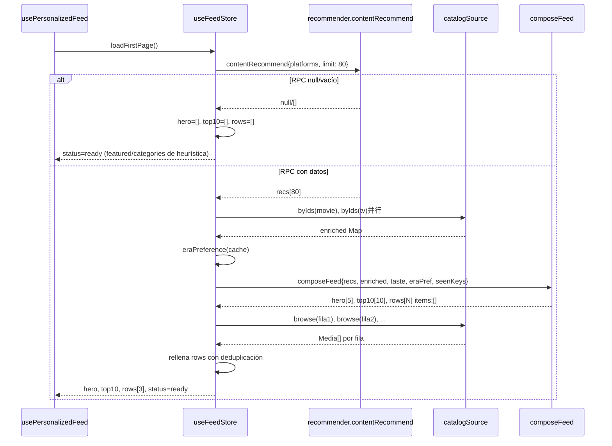

# PLAN P7 — Store y hook del feed personalización

> Solo P7. No toca pantallas ni componentes (P8/P9).
> Regla: tests primero, comprobación de fallo, luego implementación.

---

## Contexto actual (diagnóstico)

### Arquitectura existente
```
app/(tabs)/index.tsx
  └── useFeedData()           ← hook actual (se mantiene hasta P9)
        └── useFeedStore      ← Zustand store actual
              ├── loadFirstPage()
              │     ├── contentRecommend({limit: 60})  ← RPC recommend
              │     └── catalogRepository.getFeatured / getFeedCategories  ← heurística
              ├── loadNextPage()  ← heurística
              └── reset()
```

### Lo que hay que añadir (ADITIVO)
```
app/(tabs)/index.tsx
  └── useFeedData()           ← SE MANTIENE (usa featured/categories)
        └── useFeedStore      ← AMPLIADO con hero/top10/rows

src/features/feed/usePersonalizedFeed.ts  ← NUEVO hook
  └── useFeedStore             ← lee hero/top10/rows del store
```

### Dependencias clave
- `CatalogSource` (`postgrest.repository.ts:29-43`): `browse()`, `byIds()` — ya existen, firmas correctas
- `composeFeed()` (`composeFeed.ts`): función pura, ya creada en P6
- `pickHiddenGems()` (`hiddenGems.ts`): heurística para "Joyas ocultas"
- `ROW_CATALOG` + `genreExploreRow()` (`rowCatalog.ts`): definiciones de filas variadas
- `contentRecommend()` (`recommender.ts`): RPC `recommend` con `p_offset: 0` hardcodeado

### Problema detectado: bucle `while` en composeFeed.ts:241
El plan manda "prohibidos los `while`". La función `composeFeed` tiene un `while` en la alternancia de filas (~línea 241). Aunque en la práctica siempre avanza (pi o vi siempre incrementan), la regla 4 del brief lo prohíbe. Se convertirá a un algoritmo basado en `for...of`.

---

## Flujo de datos de loadFirstPage (nuevo)

```
1. contentRecommend({platforms, limit: 80})
   │
   ├─ null/vacío → degrada a heurística (getFeatured + getFeedCategories)
   │   Las razones solo pueden ser genre/era (sin explanation del RPC)
   │
   └─ tiene datos ↓

2. Enriquece con catalogSource.byIds (2 consultas paralelas: movie + tv)
   │  Las filas del RPC llegan sin géneros, año ni backdrop.
   │  Si byIds falla → sigue con datos del RPC (sin enriquecimiento)
   │
3. eraPreference: años del historial valorados ≥4 → UNA vez por sesión, cacheado
   │  Invalida caché al cambiar historial (se maneja en usePersonalizedFeed)
   │
4. composeFeed({recs, enriched, taste, eraPref, seenKeys})
   │  → {hero, top10, rows} con items: [] en filas variadas
   │
5. Rellena filas variadas con catalogSource.browse(platforms, rowParams)
   │  - Excluye seenKeys + lo ya en hero/top10/otras filas
   │  - "Joyas ocultas" usa pickHiddenGems (heurística local)
   │  - Fallo de una fila → se omite, rowsError=true
   │
6. Primera carga: hero + top10 + 3 filas
7. loadNextRows(): +2 filas por llamada
```

---

## Archivos a modificar/crear

### A) `src/store/useFeedStore.ts` — MODIFICAR (ADITIVO)

**Estado actual (SE MANTIENE):**
```ts
featured: MediaWithAffinity | null;
categories: FeedCategory[];
status: 'idle' | 'loading' | 'ready' | 'error';
page: number;
hasMore: boolean;
```

**Nuevo estado (ADITIVO):**
```ts
hero: FeedItem[];
top10: FeedItem[];
rows: FeedRow[];
rowsStatus: 'idle' | 'loading' | 'ready';  // estado de las filas variadas
rowsError: boolean;                          // error parcial de filas
rowCursor: number;                           // índice en rows definidas para paginación
```

**Cambios en loadFirstPage:**
- Mantiene toda la lógica actual (featured/categories heurística)
- ADICIONALMENTE:
  1. `contentRecommend({platforms, limit: 80})`
  2. Si hay recs: enriquece con `byIds`, calcula `eraPreference`, llama `composeFeed`
  3. Rellena filas variadas con `catalogSource.browse`
  4. Hero + Top10 + 3 filas en primera carga
  5. Si recs falla → hero=[], top10=[], rows=[] (pero featured/categories siguen de heurística)

**Nuevas acciones:**
```ts
loadNextRows: () => Promise<void>;   // +2 filas por llamada
```

**Importación de CatalogSource:**
- Importar `postgrestCatalogSource` de `@/services/supabase/catalog/postgrest.repository` directamente en el store, O
- Exportar desde `src/services/index.ts` como `catalogSource`

**Decisión:** Importar directamente `postgrestCatalogSource` del módulo postgrest. El store ya importa de `@/services` y `@/services/recommender`. El postgrest repository es lectura sola y la misma función que usa `mock.repository.ts` comparte `engine.ts`.

**EraPreference cache:**
- Variable módulo `let eraPrefCache: { key: string; value: number | null } | null = null`
- La key incluye `entries.length` para invalidar al cambiar historial
- Se recalcula en `loadFirstPage` si la key no coincide

### B) `src/services/recommender.ts` — MODIFICAR (ADITIVO)

**Cambio mínimo:**
```ts
export interface RecommendParams {
  platforms: ReadonlyArray<string>;
  limit?: number;
  type?: MediaType;
  offset?: number;  // ← NUEVO, opcional
}
```

En `contentRecommend`:
```ts
p_offset: params.offset ?? 0,  // ← usa offset si se pasa, 0 si no
```

**Contrato actual NO cambia:** offset es opcional, callers existentes siguen funcionando.

### C) `src/features/feed/usePersonalizedFeed.ts` — CREAR

```ts
interface PersonalizedFeed {
  hero: FeedItem[];
  top10: FeedItem[];
  rows: FeedRow[];
  status: 'idle' | 'loading' | 'ready' | 'error';
  platforms: string[];
  setPlatforms(ids: string[]): void;
  reload(): void;
  loadMoreRows(): Promise<void>;
  loadingMore: boolean;
  rowsError: boolean;
}
```

**Invalidación (de useFeedData):**
- `useEffect` sobre `[initialRatings, hasOnboarded, entries, watched]` → `reset()` si cambian
- `useEffect` sobre `status === 'idle' && platforms.length > 0` → `loadFirstPage()`

**Carga automática:** misma lógica que `useFeedData`: cuando status es idle y hay plataformas.

**setPlatforms:** actualiza `useProfileStore.setFavoritePlatforms` + `reset()` + `loadFirstPage()`.

**loadMoreRows:** envuelve `useFeedStore.loadNextRows()` con `loadingMore` state local.

### D) `src/features/feed/composeFeed.ts` — MODIFICAR (CORRECCIÓN)

**Problema:** bucle `while` en la alternancia de filas (línea ~241).
**Solución:** reemplazar por un algoritmo basado en arrays y `for...of`.

```ts
// Antes (PROHIBIDO):
while (pi < personalizedRows.length || vi < variedRows.length) {
  // ...
}

// Después (for...of sobre colección finita):
const totalSlots = personalizedRows.length + variedRows.length;
const pairs = Array.from({ length: Math.ceil(totalSlots / 2) }, (_, i) => i);
for (const _ of pairs) {
  // toma de personalizada, luego de variada, si existen
}
```

O más limpio:
```ts
const rows: FeedRow[] = [];
const maxLen = Math.max(personalizedRows.length, variedRows.length);
for (let i = 0; i < maxLen; i++) {
  if (i % 2 === 0) {
    // par: personalizada primero
    if (i < personalizedRows.length) rows.push(personalizedRows[i]);
    if (i < variedRows.length) rows.push(variedRows[i]);
  } else {
    // impar: variada primero
    if (i < variedRows.length) rows.push(variedRows[i]);
    if (i < personalizedRows.length) rows.push(personalizedRows[i]);
  }
}
```

### E) Tests — CREAR/MODIFICAR

#### 1. `src/store/useFeedStore.test.ts` — AMPLIAR

**Nuevos tests:**
- "carga con RPC → hero, top10, rows poblados"
- "RPC null → hero=[], top10=[], rows=[], pero featured/categories de heurística"
- "RPC vacío → igual que null"
- "byIds que falla → sigue con datos del RPC (sin géneros/año)"
- "fila variada que falla → rowsError=true, las otras filas salen"
- "sin duplicados media_type:id entre hero, top10 y filas"
- "vistos excluidos del feed"
- "reset durante carga → descarta resultado viejo (reqId)"

**Mocks adicionales:**
```ts
jest.mock('@/services/supabase/catalog/postgrest.repository', () => ({
  postgrestCatalogSource: {
    byIds: jest.fn(),
    browse: jest.fn(),
  },
}));
```

**Tests existentes:** deben seguir pasando. Los tests de `featured`/`categories` usan la ruta heurística o content con el formato actual. Como el nuevo estado es aditivo y no borra el viejo, los tests existentes no se rompen.

#### 2. `src/features/feed/usePersonalizedFeed.test.ts` — CREAR

**Usa `renderHook` de `@testing-library/react`:**
```ts
import { renderHook, act, cleanup } from '@testing-library/react';
```

**Tests:**
- "idle → loading → ready con plataformas"
- "cambio de gusto (entries) → resetea y recarga"
- "setPlatforms(ids) → recarga feed"
- "loadMoreRows añade 2 filas"
- "loadMoreRows no hace nada si loadingMore=true"
- "sin setState tras desmontar" (cleanup + promesa pendiente)
- "sin plataformas → status idle, no carga"

#### 3. Test de "sin campos numéricos de nota"

**Puede ir en `useFeedStore.test.ts` o en un archivo separado:**
```ts
it('ningún ítem en hero/top10/filas tiene campos numéricos de nota', () => {
  // ...carga feed...
  const allItems = [...hero, ...top10, ...rows.flatMap(r => r.items)];
  for (const item of allItems) {
    expect(item).not.toHaveProperty('tenths');
    expect(item).not.toHaveProperty('score');
    expect(item).not.toHaveProperty('prediction');
  }
});
```

#### 4. Test de regresión pickHero

**En `composeFeed.test.ts`:**
```ts
it('dos recs del mismo género con segundo backdrop → devuelve 2 sin colgar', () => {
  const recs = [
    rec(movie(1, 'M1', [18], false, 2020), 0.8),  // drama, sin backdrop
    rec(movie(2, 'M2', [18], true, 2020), 0.7),   // drama, con backdrop
  ];
  const result = composeFeed({ recs, ... });
  expect(result.hero.length).toBe(2);
});
```

#### 5. Tests existentes que deben seguir pasando

- `useFeedStore.test.ts` (tests actuales de featured/categories)
- `feedMood.test.ts` (usa `useFeedStore` con heurística)
- `persistence.test.ts` (verifica que Feed no usa persist)
- `composeFeed.test.ts` (tests de composición pura)

---

## Diagrama de flujo



---

## Orden de ejecución

1. **B) `recommender.ts`** — Añadir `offset` (cambio trivial, 2 líneas)
2. **Corregir `composeFeed.ts`** — Bucle while → for (regla 4)
3. **Tests de composeFeed** — Verificar corrección del bucle + regresión pickHero
4. **Tests de useFeedStore** — Escribir tests NUEVOS (fallan sin implementación)
5. **A) `useFeedStore.ts`** — Implementar nuevo estado y lógica
6. **Verificar tests existentes** — feedMood, persistence, useFeedStore originales
7. **Tests de usePersonalizedFeed** — Escribir tests (fallan sin hook)
8. **C) `usePersonalizedFeed.ts`** — Crear hook
9. **Test sin campos numéricos** — Verificación global
10. **Batería final** — tsc, eslint, jest, auditoria-estilos

---

## Decisiones técnicas

| Decisión | Rationale |
|---|---|
| Estado nuevo ADITIVO en useFeedStore | Mantiene backward compatibility con useFeedData (P9 lo borra) |
| Importar postgrestCatalogSource directamente | Evita exponer internos en services/index.ts; el store ya importa de submódulos |
| eraPref cache por sesión con invalidación por entries.length | Equilibrio entre rendimiento y frescura; no hace falta precisión frame-a-frame |
| Filas variadas vacías en composeFeed, se rellenan en el store | composeFeed es pura (sin acceso a catálogo); el store gestiona IO |
| loadNextRows añade 2 filas | Como especifica el plan §3.3 |
| rowsError solo si fallan filas variadas | El plan dice "un fallo al rellenar una fila NO rompe el feed" |
| status='error' solo si fallan recs Y heurística | Degradación progresiva |
| request pattern para reset | Ya existe en el store actual (requestId), se reutiliza |

---

## Riesgos y mitigación

| Riesgo | Mitigación |
|---|---|
| byIds lento (2 consultas extra) | En paralelo (Promise.all); si falla se sigue adelante |
| Demasiados items sin plataformas | browse filtra por plataformas del usuario |
| Deduplicación costosa | Set de strings media_type:id; O(n) trivial |
| Tests existentes rompen | Estado aditivo; los tests acceden a featured/categories que no cambian |
| ComposeFeed con while bucle infinito | Convertido a for...of antes de implementar store |
| eraPref cache desactualizado | Se invalida al cambiar entries (uso de key con length) |
